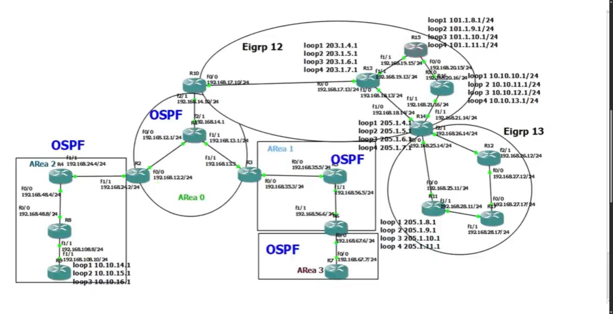

# OSPF Multi-Area Lab (GNS3)

A multi-area OSPF lab built in GNS3, with redistribution between OSPF and two EIGRP autonomous systems.

## Topology

17 Cisco routers in GNS3.

| Domain | Routers |
|---|---|
| OSPF Area 0 (backbone) | R1, R2, R3, R10 |
| OSPF Area 1 | R3, R5, R6 |
| OSPF Area 2 | R2, R4, R8, R9 |
| OSPF Area 3 | R6, R7 (reached through a virtual link) |
| EIGRP 12 | R10, R13, R14, R15, R16 |
| EIGRP 13 | R14, R11, R12, R17 |

Boundary routers: R10 (OSPF and EIGRP 12) and R14 (EIGRP 12 and EIGRP 13).

## What the lab covers

- Basic configuration on physical interfaces and loopbacks
- Multi-area OSPF (Areas 0, 1, 2 and 3), including OSPF over an interface range
- Passive interfaces in OSPF and EIGRP
- Routing between different EIGRP autonomous systems (EIGRP 12 and 13)
- Redistribution between EIGRP and OSPF
- Static default route advertised into OSPF
- Virtual link
- Unicast OSPF neighbors (R1 and R3)
- MD5 authentication (R4–R8 and R8–R9)
- Summarisation on R10 (203.1.4.0)
- Prefix-list filtering on R2 in Area 2

The topology image is a frame from the lab recording. A full walkthrough video is in the LinkedIn post.

Lab write-up on LinkedIn: [OSPF lab post](https://www.linkedin.com/feed/update/urn:li:activity:7324851226469187584/)

Thanks to Eng. Mohamed El Hady.
